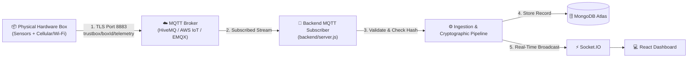

# 📦 TrustBox — Tamper-Evident Delivery Black Box & Instant Parametric Insurance

> **Cryptographically verifiable IoT cargo monitoring, recursive SHA-256 hash chaining, HMAC-SHA256 device authentication, and automated parametric insurance settlements.**

---

## 📑 Table of Contents
1. [Project Overview](#1-project-overview)
2. [Hardware Integration: Current Status and Planned Workflow](#2-hardware-integration-current-status-and-planned-workflow)
3. [Telemetry JSON Contract](#3-telemetry-json-contract)
4. [Cryptographic Integrity & Hash-Chain Architecture](#4-cryptographic-integrity--hash-chain-architecture)
5. [Backend Architecture](#5-backend-architecture)
6. [Frontend Architecture](#6-frontend-architecture)
7. [Parametric Insurance Engine](#7-parametric-insurance-engine)
8. [REST API & WebSocket Documentation](#8-rest-api--websocket-documentation)
9. [Local Development & Setup Guide](#9-local-development--setup-guide)
10. [Hardware Telemetry Simulator (`fake-publisher.js`)](#10-hardware-telemetry-simulator-fake-publisherjs)
11. [Planned MQTT Integration](#11-planned-mqtt-integration)
12. [Information Required from the Hardware Team](#12-information-required-from-the-hardware-team)
13. [Testing & Verification](#13-testing--verification)
14. [Demo Devices & Demonstration Workflow](#14-demo-devices--demonstration-workflow)
15. [Security Model, Limitations & Production Readiness](#15-security-model-limitations--production-readiness)
16. [Project Roadmap](#16-project-roadmap)

---

## 1. Project Overview

**TrustBox** is an end-to-end cargo-monitoring and automated claim-settlement platform designed for high-value and cold-chain logistics (such as vaccines, biologics, premium electronics, and sensitive custody parcels). The platform continuously monitors environmental parameters and custody conditions, maintains an auditable tamper-evident cryptographic ledger, and triggers instant parametric insurance settlements when cargo conditions are breached.

The project is structured into two collaborative domains:

```
┌────────────────────────────────────────────────────────┐
│                   TRUSTBOX SYSTEM                      │
├────────────────────────────┬───────────────────────────┤
│       HARDWARE SIDE        │       SOFTWARE SIDE       │
│  (Physical Black Box Device) │  (Cloud & Analytics Node) │
├────────────────────────────┼───────────────────────────┤
│ • Sensor readings          │ • HTTP Telemetry Ingestion│
│ • Microcontroller firmware │ • Schema & Range Checks   │
│ • JSON payload formatting  │ • Cryptographic Audit     │
│ • Transmission to backend  │ • MongoDB Atlas Ledger    │
│   (HTTP active, MQTT plan) │ • Parametric Claims Engine│
│                            │ • Real-Time Web Dashboard │
│                            │ • Mobile QR Verify Portal │
└────────────────────────────┴───────────────────────────┘
```

### A. Hardware Side (Under Development)
- Developed by the hardware engineering team.
- Responsible for the physical enclosure, power supply, sensors (temperature, humidity, impact/shock, orientation/tilt, ambient light, lid-open detection), and microcontroller firmware.
- The physical hardware is expected to format sensor measurements into structured JSON payloads and transmit them to the software backend.
- **Current Communication Status:** The hardware team has not finalised the hardware components, microcontroller model, or transmission protocol. While MQTT is a probable integration path, **no MQTT broker, credentials, or live hardware connections are currently operational**. Direct HTTP POST transmission is the currently implemented and functional integration mechanism.

### B. Software Side (Fully Implemented)
- Built on a **Node.js/Express** backend, **MongoDB Atlas** persistence, **Socket.IO** real-time broadcasting, and a **React 18 + Vite** dark-theme security dashboard.
- Every ingested record is verified against an immutable recursive **SHA-256 hash chain** and an **HMAC-SHA256** device key signature.
- An automated **Parametric Insurance Engine** evaluates cold-chain breaches (>8.0°C sustained for $\ge$15s) and shock/drop events, triggering instant simulated payouts (`pay_xxx`).
- A responsive QR verification interface allows independent auditing via any mobile browser (`/verify/:boxId`).

---

## 2. Hardware Integration: Current Status and Planned Workflow

The software and hardware components interact across a defined custody lifecycle:

```mermaid
flowchart TD
    HW["📦 Physical Hardware / Simulator<br/>(Sensors & Microcontroller)"] -->|1. Formats JSON Payload| PAYLOAD["📄 Structured Telemetry JSON"]
    PAYLOAD -->|2. HTTP POST Ingestion (Implemented)<br/>or MQTT Publish (Planned)| BACKEND["⚙️ Node.js + Express Backend<br/>(Validation & Ingestion Pipeline)"]
    BACKEND -->|3. Schema & Physical Range Checks| VAL{"Valid?"}
    VAL -->|No| REJ["❌ Reject Payload (HTTP 400 / 401 / 409)"]
    VAL -->|Yes| CRYPTO["🔒 Cryptographic Hash & HMAC Audit"]
    CRYPTO -->|4. Store Record| DB[("🗄️ MongoDB Atlas Ledger<br/>(records collection)")]
    CRYPTO -->|5. Real-Time Broadcast| WS["⚡ Socket.IO WebSockets"]
    CRYPTO -->|6. Condition Evaluation| INS["🛡️ Parametric Insurance Engine"]
    INS -->|Breach Detected| CLAIM["💰 Auto-Approved Claim & Payout"]
    WS -->|7. Live Telemetry & Events| DASH["💻 React + Vite Dashboard"]
    DB -->|8. Independent Verification| QR["📱 Mobile QR Audit Page (/verify/:boxId)"]
```

### Current Status Table

| Component | Status | Notes |
| :--- | :--- | :--- |
| **Backend HTTP Ingestion** | **Implemented** | `POST /api/records` validates schema, range, signatures, and sequence continuity. |
| **JSON Telemetry Format** | **Defined** | Formal schema defined and enforced in backend validator. |
| **Fake Telemetry Publisher** | **Implemented** | Node.js emulator (`fake-publisher.js`) simulates journeys and breach scenarios. |
| **Physical Hardware Prototype** | **Under Development** | Breadboard / prototype firmware in progress by hardware team (`firmware/`). |
| **Hardware JSON Integration** | **Pending Confirmation** | Awaiting sample JSON generated by physical hardware. |
| **MQTT Broker Configuration** | **Not Finalised** | MQTT code exists in `server.js` as fallback skeleton; no live broker is configured. |
| **MQTT Hardware Connectivity** | **Not Yet Tested** | Blocked pending hardware selection and broker setup. |
| **Live Hardware-to-Dashboard Workflow** | **Pending Integration** | Software stack is verified via HTTP simulator; physical device handoff pending. |

---

## 3. Telemetry JSON Contract

The backend exposes a strict contract for ingested records at `POST /api/records`. Every payload must satisfy structural, physical range, and cryptographic verification rules.

### Illustrative JSON Payload Example
*(Note: Example only. Hashes and signatures shown are illustrative placeholders).*

```json
{
  "box_id": "TB-DEMO-01",
  "seq": 214,
  "ts": 1793471853,
  "temp_c": 6.5,
  "humidity": 55.2,
  "shock": 0,
  "tilt": 0,
  "flipped": 0,
  "light": 35,
  "lid_open": 0,
  "event": "NONE",
  "prev_hash": "a1b2c3d4e5f60718293a4b5c6d7e8f90a1b2c3d4e5f60718293a4b5c6d7e8f90",
  "hash": "b2c3d4e5f60718293a4b5c6d7e8f90a1b2c3d4e5f60718293a4b5c6d7e8f90a1",
  "sig": "c3d4e5f60718293a4b5c6d7e8f90a1b2c3d4e5f60718293a4b5c6d7e8f90a1b2"
}
```

### Complete Field Specification

| Field Name | Expected Type | Required? | Meaning / Units | Validation & Range Restrictions |
| :--- | :--- | :---: | :--- | :--- |
| `box_id` | String | **Yes** | Unique identifier for physical parcel/box. | Non-empty string; trimmed; e.g. `"TB-001"`, `"TB-DEMO-01"`. |
| `seq` | Integer | **Yes** | Monotonically increasing sequence number. | Non-negative integer ($\ge 0$). Must strictly equal `previous_seq + 1` (or `0` for genesis). Gaps rejected with HTTP 400; duplicates rejected with HTTP 409. |
| `ts` | Integer | **Yes** | UNIX timestamp in seconds (epoch time). | Positive integer ($> 0$). Generated at time of measurement. |
| `temp_c` | Float / Number | **Yes** | Internal cargo temperature in Celsius. | Numeric float formatted to **1 decimal place**; valid physical range: $-60.0^\circ\text{C}$ to $120.0^\circ\text{C}$. |
| `humidity` | Float / Number | **Yes** | Relative humidity percentage (%RH). | Numeric float formatted to **1 decimal place**; valid range: $0.0\%$ to $100.0\%$. |
| `shock` | Integer / Boolean | **Yes** | High-g impact or drop detection flag. | Binary `0` (normal) or `1` (shock detected). Boolean `false`/`true` normalized to `0`/`1`. |
| `tilt` | Integer / Boolean | **Yes** | Angular inclination tilt flag ($> 45^\circ$). | Binary `0` (upright) or `1` (tilted). |
| `flipped` | Integer / Boolean | **Yes** | Complete inversion flag ($> 135^\circ$). | Binary `0` (upright) or `1` (inverted/upside-down). |
| `light` | Integer | **Yes** | Ambient light reading inside box (lux). | Non-negative integer ($\ge 0$). High reading indicates enclosure penetration. |
| `lid_open` | Integer / Boolean | **Yes** | Enclosure switch state flag. | Binary `0` (sealed/closed) or `1` (box opened). |
| `event` | String | **Yes** | Categorical custody event classification. | String enum: `"NONE"`, `"TEMP_BREACH"`, `"DROP"`, `"FLIPPED"`, `"LID_OPEN"`, `"DELIVERED"`. Defaults to `"NONE"` if empty. |
| `prev_hash` | String (Hex) | **Yes** | SHA-256 hash of previous record. | Exactly 64 lowercase hexadecimal characters. Genesis record (`seq = 0`) must be exactly 64 zeroes (`0000...0000`). |
| `hash` | String (Hex) | **Yes** | SHA-256 hash of canonical serialization. | Exactly 64 lowercase hexadecimal characters. Must match `SHA256(canonical_string)`. |
| `sig` | String (Hex) | **Yes** | HMAC-SHA256 device key signature. | Exactly 64 lowercase hexadecimal characters. Must match `HMAC-SHA256(DEVICE_KEY, hash)`. |

> [!IMPORTANT]
> **Data Type Parity Requirement:** The hardware team must ensure consistent types. Booleans should be sent as numeric integers (`0` or `1`) or native booleans (`false`/`true`). Field names are case-sensitive.

---

## 4. Cryptographic Integrity & Hash-Chain Architecture

TrustBox implements zero-trust verification: data at rest in the database is not inherently trusted. Any party scanning the QR code or querying the API can cryptographically re-audit the ledger from Genesis to the latest record.

### 1. Canonical Serialization String
To guarantee identical cryptographic hashes across heterogeneous platforms (embedded C/C++ firmware and Node.js), record fields must be converted into a deterministic string joined by the pipe (`|`) delimiter in this strict canonical order:

$$\text{box\_id} \mid \text{seq} \mid \text{ts} \mid \text{temp\_c} \mid \text{humidity} \mid \text{shock} \mid \text{tilt} \mid \text{flipped} \mid \text{light} \mid \text{lid\_open} \mid \text{event} \mid \text{prev\_hash}$$

#### Canonicalization Rules:
- Floating-point fields (`temp_c`, `humidity`) strictly formatted to 1 decimal place (`Number(val).toFixed(1)`).
- Boolean flags (`shock`, `tilt`, `flipped`, `lid_open`) normalized to numeric `0` or `1`.
- Ambient light converted to integer (`parseInt(val, 10) || 0`).
- If `event` is absent or whitespace, normalized to `"NONE"`.
- Hashes and signatures converted to lowercase strings.

### 2. Recursive SHA-256 Hash Chaining
The record hash is computed over the UTF-8 bytes of the canonical string:

$$\text{hash} = \text{SHA-256}(\text{canonical\_string})$$

Every subsequent record embeds the prior record's hash in its `prev_hash` field, creating an unbroken cryptographic link:

$$\text{Record}_{n}.\text{prev\_hash} = \text{Record}_{n-1}.\text{hash}$$

### 3. Genesis Block Anchor
The initial record (`seq = 0`) has no predecessor and is anchored to a 64-character string of ASCII zeroes:

$$\text{Record}_{0}.\text{prev\_hash} = \text{"0000000000000000000000000000000000000000000000000000000000000000"}$$

### 4. Symmetric HMAC-SHA256 Authentication
The payload signature is computed using HMAC-SHA256 over the computed hash using a pre-shared secret key:

$$\text{sig} = \text{HMAC-SHA256}(\text{DEVICE\_KEY}, \text{hash})$$

> [!NOTE]
> **Cryptographic Clarification (Symmetric vs Asymmetric):**
> TrustBox uses **symmetric-key HMAC-SHA256**, not asymmetric public/private key cryptography. The physical device and the backend share a private pre-shared key (`DEVICE_KEY`). This authenticates that telemetry originated from an authorized box and has not been altered in transit or database storage. It does not provide asymmetric non-repudiation against an entity possessing the device secret.

### 5. Chain Verification Algorithm
The verification engine ([`backend/chain.js`](file:///home/sky/Documents/trustbox-main/backend/chain.js)) traverses records sorted by `seq` ascending and verifies:
1. **Genesis Rule:** Record #0 must have `seq === 0` and `prev_hash` matching the 64-zero genesis string.
2. **Sequence Continuity:** Every record must satisfy $\text{seq}_i = \text{seq}_{i-1} + 1$. Duplicate sequence numbers and sequence gaps immediately break verification.
3. **Linkage Continuity:** Every record must satisfy $\text{prev\_hash}_i = \text{hash}_{i-1}$.
4. **Content Integrity:** The canonical string is reconstructed from payload fields. If $\text{SHA256}(\text{canonical}) \neq \text{hash}$, tampering is flagged at that sequence.
5. **Signature Authenticity:** $\text{HMAC-SHA256}(\text{DEVICE\_KEY}, \text{hash}) == \text{sig}$. An invalid signature indicates unauthorized payload generation.

---

## 5. Backend Architecture

The backend is built with Express 4, Mongoose 8, Socket.IO 4, and Node.js native `crypto`.

```
backend/
├── chain.js              # Canonical string builder, SHA-256, HMAC-SHA256 & verifyChain logic
├── fake-publisher.js     # Hardware simulator with automatic sequence resumption & CLI flags
├── insurance.js          # Parametric insurance engine (duration tracking, claim & payout generation)
├── models.js             # Mongoose schemas: Record, Claim, Payout
├── package.json          # Dependencies & npm scripts (start, dev, simulate, test, test:api)
├── package-lock.json
├── server.js             # Express app, Socket.IO server, ingestion validation, REST endpoints
├── test-api.js           # 17-point automated API & insurance integration test suite
└── test-chain.js         # 11-point cryptographic unit test suite
```

### Module Responsibilities
- **[`server.js`](file:///home/sky/Documents/trustbox-main/backend/server.js):** Configures HTTP server on port 4000, connects to MongoDB Atlas (with in-memory fallback), enforces ingestion validation schema, handles REST endpoints, and manages Socket.IO live connections. Contains unconfigured MQTT connection skeleton.
- **[`chain.js`](file:///home/sky/Documents/trustbox-main/backend/chain.js):** Pure cryptographic library. Exports `buildCanonicalString`, `computeHash`, `computeSignature`, `signRecord`, `verifySingleRecord`, and `verifyChain`.
- **[`insurance.js`](file:///home/sky/Documents/trustbox-main/backend/insurance.js):** Stateful evaluation engine tracking active journey breaches. Handles threshold timing windows and prevents duplicate claims across restarts.
- **[`models.js`](file:///home/sky/Documents/trustbox-main/backend/models.js):** Defines MongoDB schemas:
  - `Record`: Stores telemetry documents with compound unique index on `{ box_id: 1, seq: 1 }`.
  - `Claim`: Stores approved claims (`TEMP_BREACH`, `DROP`, `TILT`, `TAMPER`) with trigger sequence and timestamp.
  - `Payout`: Stores simulated settlement payouts (`payout_id`, `amount_inr`, `status`, `beneficiary`).

---

## 6. Frontend Architecture

The frontend is a single-page React 18 application built with Vite 5 and Tailwind CSS.

```
frontend/
├── index.html            # Main HTML document with Leaflet CSS link
├── package.json          # Frontend dependencies (react, recharts, leaflet, socket.io-client, etc.)
├── vite.config.js        # Vite config with proxy routing /api and /socket.io to backend port 4000
└── src/
    ├── App.jsx           # React Router route setup (/ and /verify/:boxId)
    ├── main.jsx          # React DOM root render
    ├── index.css         # Tailwind directives, custom glassmorphism styles and glow utilities
    ├── components/
    │   ├── PayoutCard.jsx   # Payout settlement banner with confetti burst animation
    │   ├── QRCodeModal.jsx  # QR code generation modal linking to /verify/:boxId
    │   └── RouteMap.jsx     # Leaflet corridor replay with simulated transit waypoints
    └── pages/
        ├── Dashboard.jsx # Main live monitoring dashboard (device selection, charts, judge controls)
        └── VerifyPage.jsx # Mobile-friendly forensic chain verification page
```

### Key Frontend Features
- **Device Selection Bar:** Direct `<select>` dropdown populated from `/api/boxes`, quick-switch chips (`TB-DEMO-01`, `TB-TEST`, `TB-001`), and custom box input with dedicated "Load" button.
- **Race-Condition Protection:** Employs an active request tracking ref (`activeRequestIdRef`) to guarantee that out-of-order responses for previous devices never overwrite the active device.
- **Live Telemetry & Metrics:** Metric cards for Temperature, Humidity, Shock/Drop, and Lid Switch state with color-coded warning thresholds.
- **Live Recharts Temperature Stream:** Renders temperature history with an 8.0°C dashed red breach threshold line.
- **Simulated Corridor Map:** Leaflet map animating transit waypoints between cargo gateway and destination hub. Clearly labeled as a **simulated replay** (device has no onboard GPS receiver).
- **Hackathon Judge Controls:** Controlled tamper demonstration button that calls `/api/admin/tamper` and triggers immediate forensic failure reporting.

---

## 7. Parametric Insurance Engine

TrustBox automates insurance claim adjudication and instant settlement generation using deterministic parameter rules implemented in [`backend/insurance.js`](file:///home/sky/Documents/trustbox-main/backend/insurance.js).

### Implemented Trigger Conditions

#### 1. Cold-Chain Temperature Breach (`TEMP_BREACH`)
- **Threshold:** Temperature $> 8.0^\circ\text{C}$ (`CLAIM_TEMP_C`).
- **Duration Requirement:** Sustained breach for at least **15 seconds** (`CLAIM_WINDOW_SEC`).
- **Timing Logic:** The engine records `tempExceedStartTs` on the first record exceeding 8.0°C. If temperature returns to $\le 8.0^\circ\text{C}$ before 15 seconds elapse, the timer resets to `null`. If $(ts - \text{tempExceedStartTs}) \ge 15\text{s}$, a claim is approved.
- **Settlement Amount:** **₹50,000** (Simulated instant mock settlement).

#### 2. High Shock / Drop Impact Event (`DROP`)
- **Threshold:** `shock === 1` or `event === 'DROP'`.
- **Timing Logic:** Triggered on immediate receipt of a high-g shock event.
- **Settlement Amount:** **₹25,000** (Simulated instant mock settlement).

### Claim Deduplication & Lifecycle
- Before approving a claim, the engine queries MongoDB (`Claim.findOne({ box_id, type })`) and checks in-memory journey flags (`hasTempClaim`, `hasDropClaim`).
- Only **one** temperature breach claim and **one** drop claim are approved per box journey, preventing duplicate payouts.
- Payout records are assigned unique identifiers (`pay_xxxx`), marked as `status: "TRANSFERRED"`, and broadcast to connected clients via Socket.IO events (`io.emit('claim')`, `io.emit('payout')`).

> [!NOTE]
> **Simulation Disclosure:** Payout identifiers (`pay_xxx`) and settlements represent automated parametric insurance simulations for demonstration purposes and do not execute live banking disbursements.

---

## 8. REST API & WebSocket Documentation

The backend runs on `http://localhost:4000`. All API routes are prefixed with `/api`.

### Endpoints Overview

| Method | Endpoint | Purpose | Access Level |
| :--- | :--- | :--- | :--- |
| `GET` | `/health` | Backend and database connectivity health check | Public |
| `GET` | `/` | Root service directory and endpoint list | Public |
| `GET` | `/api/boxes` | Retrieve list of registered device box IDs | Public |
| `GET` | `/api/devices/:boxId/latest` | Retrieve latest sequence and hash to resume chain | Public |
| `GET` | `/api/records/:boxId` | Retrieve stored historical telemetry records | Public |
| `POST` | `/api/records` | Ingest new signed telemetry record | Device / Ingestion |
| `GET` | `/api/verify/:boxId` | Cryptographic audit of full hash chain | Public |
| `GET` | `/api/claims/:boxId` | Retrieve insurance claims for a box | Public |
| `GET` | `/api/payouts/:boxId` | Retrieve settlement payouts for a box | Public |
| `POST` | `/api/admin/tamper/:boxId/:seq` | Maliciously alter a record in storage (Demo) | Testing / Judge |
| `POST` | `/api/admin/reset/:boxId` | Clear records and reset engine for a box | Testing / Judge |

---

### Detailed Endpoint Specifications

#### 1. Ingest Telemetry: `POST /api/records`
- **Purpose:** Ingests, validates, verifies, and stores a signed telemetry payload.
- **Request Body:** JSON telemetry payload matching the contract.
- **Success Response (HTTP 201 Created):**
  ```json
  {
    "status": "received",
    "box_id": "TB-DEMO-01",
    "seq": 215,
    "hash": "b2c3d4e5f60718293a4b5c6d7e8f90a1b2c3d4e5f60718293a4b5c6d7e8f90a1"
  }
  ```
- **Error Responses:**
  - `HTTP 400 Bad Request`: Malformed schema, physical range violation, sequence gap, or broken `prev_hash` link.
  - `HTTP 401 Unauthorized`: Invalid HMAC signature (`DEVICE_KEY` mismatch).
  - `HTTP 409 Conflict`: Duplicate sequence number ($\text{seq} \le \text{latest\_seq}$).

#### 2. Verify Hash Chain: `GET /api/verify/:boxId`
- **Purpose:** Audits the complete sequence of records for the specified box from Genesis to tip.
- **Success Response — Valid Chain (HTTP 200):**
  ```json
  {
    "ok": true,
    "empty": false,
    "count": 54,
    "brokenAt": null,
    "latestHash": "a21020c5dec3f3cbbd54c26a88f7d3f8b6f871f4c92908e5d79484a17e212cec"
  }
  ```
- **Success Response — Tampered Chain (HTTP 200):**
  ```json
  {
    "ok": false,
    "count": 5,
    "brokenAt": 2,
    "latestHash": "704e033e85f58f795d265a7e41d327bd013056627aa29ce30c635751a79b15aa",
    "reason": "Hash mismatch at seq #2. Expected: eb99..., got: 2125..."
  }
  ```
- **Success Response — Empty Ledger (HTTP 200):**
  ```json
  {
    "ok": true,
    "empty": true,
    "count": 0,
    "brokenAt": null,
    "latestHash": null,
    "genesisHash": "0000000000000000000000000000000000000000000000000000000000000000",
    "reason": "No telemetry records stored for this box ID."
  }
  ```

#### 3. Retrieve Records: `GET /api/records/:boxId`
- **Query Parameters:** `?limit=N` (defaults to 100, max arbitrary integer).
- **Success Response (HTTP 200):** Array of record objects sorted ascending by `seq`.

#### 4. Retrieve Latest Device State: `GET /api/devices/:boxId/latest`
- **Success Response (HTTP 200):**
  ```json
  {
    "box_id": "TB-DEMO-01",
    "exists": true,
    "latestSeq": 53,
    "latestHash": "a21020c5dec3f3cbbd54c26a88f7d3f8b6f871f4c92908e5d79484a17e212cec",
    "nextSeq": 54,
    "prevHash": "a21020c5dec3f3cbbd54c26a88f7d3f8b6f871f4c92908e5d79484a17e212cec",
    "timestamp": 1793471853
  }
  ```

#### 5. Admin Tamper Simulation: `POST /api/admin/tamper/:boxId/:seq`
- **Purpose:** Hackathon demonstration tool. Mutates `temp_c` in database storage without recalculating hash or signature.
- **Success Response (HTTP 200):**
  ```json
  {
    "success": true,
    "message": "Record #2 of TB-TEST was tampered! temp_c is now 4.5",
    "record": { "box_id": "TB-TEST", "seq": 2, "temp_c": 4.5 }
  }
  ```

#### 6. Admin Reset: `POST /api/admin/reset/:boxId`
- **Purpose:** Clears records, claims, payouts, and engine state for demonstration reset.
- **Safety Rule:** Device `TB-TEST` is protected against accidental wipeout and requires `{ "confirm": true }` in the request body.

---

### WebSocket (Socket.IO) Events

- **`connection` / `disconnect`:** Connection lifecycle.
- **`record` (Server $\rightarrow$ Client):** Broadcasts every newly ingested record.
- **`event` (Server $\rightarrow$ Client):** Broadcasts records where `event !== 'NONE'`.
- **`claim` (Server $\rightarrow$ Client):** Broadcasts newly approved insurance claims.
- **`payout` (Server $\rightarrow$ Client):** Broadcasts generated settlement payout objects.
- **`tamper` (Server $\rightarrow$ Client):** Broadcasts `{ box_id, seq, new_temp }` when tamper demo executes.
- **`reset` (Server $\rightarrow$ Client):** Broadcasts `{ box_id }` when demo reset executes.

---

## 9. Local Development & Setup Guide

### Prerequisites
- **Node.js:** v18.0.0 or later (verified on v20.20.2).
- **npm:** v9.0.0 or later (verified on v10.8.2).
- **MongoDB Atlas:** Connection URI (or local MongoDB). If MongoDB is offline, the backend automatically falls back to an in-memory store.

### Environment Configuration
The backend expects configuration variables in `backend/.env`. Placeholder template:

```env
PORT=4000
MONGODB_URI=mongodb+srv://<username>:<password>@<cluster>.mongodb.net/trustbox?retryWrites=true&w=majority
MONGO_URI=mongodb+srv://<username>:<password>@<cluster>.mongodb.net/trustbox?retryWrites=true&w=majority

# MQTT Configuration (Planned - Leave commented out if not using live broker)
# MQTT_URL=mqtts://<broker-hostname>:8883
# MQTT_USER=<username>
# MQTT_PASS=<password>

DEVICE_KEY=trustbox-super-secret-key-32ch
CLAIM_TEMP_C=8.0
CLAIM_WINDOW_SEC=15
```

> [!CAUTION]
> Never commit actual passwords, MongoDB URIs, or `DEVICE_KEY` to public repositories.

### Installation & Startup Steps

#### 1. Start Backend Server
```bash
cd backend
npm install
npm run dev
```
Backend starts on **`http://localhost:4000`**.

#### 2. Start Frontend Dashboard
In a separate terminal:
```bash
cd frontend
npm install
npm run dev
```
Dashboard starts on **`http://localhost:3000`**.

#### 3. Automated One-Command Demo Runner
The repository includes a helper shell script:
```bash
./start-demo.sh
```
This script checks Node/npm, installs backend/frontend dependencies if missing, and executes the cryptographic unit test suite.

---

## 10. Hardware Telemetry Simulator (`fake-publisher.js`)

Located in [`backend/fake-publisher.js`](file:///home/sky/Documents/trustbox-main/backend/fake-publisher.js), the hardware emulator generates cryptographically signed, hash-chained records identical to physical device transmissions.

### Execution Command
From the `backend/` directory:
```bash
node fake-publisher.js --boxId TB-DEMO-01 --http
```

### Automatic State Resumption
The simulator queries `GET /api/devices/:boxId/latest` before starting:
- **Existing Device:** Resumes sequence `#nextSeq` using `latestHash` as `prev_hash`. Prevents sequence collisions (`E11000 duplicate key`).
- **New Device:** Initializes from Genesis (`seq = 0`, `prev_hash = 64 zeros`).

### CLI Scenario Flags

| Flag | Parameter | Description |
| :--- | :--- | :--- |
| `--boxId <id>` | String (default: `TB-001`) | Target device ID for simulated transmissions. |
| `--count <N>` | Integer (default: continuous) | Transmit exactly $N$ records and exit. |
| `--interval <ms>` | Integer (default: 1500) | Transmission cadence in milliseconds. |
| `--heat` | Boolean flag | Simulates cold-chain heat breach (~14.5°C). Triggers claim after 15s. |
| `--drop` | Boolean flag | Simulates high-impact physical shock event. Triggers instant claim. |
| `--flipped` | Boolean flag | Simulates parcel inversion / upside-down event. |
| `--lid` | Boolean flag | Simulates opened enclosure lid switch and high ambient light (350 lux). |
| `--fresh` | Boolean flag | Enforces genesis mode; aborts if box already has records. |
| `--http` | Boolean flag | Forces direct HTTP transmission to `http://localhost:4000/api/records`. |

---

## 11. Planned MQTT Integration

MQTT represents a planned integration path for wireless telemetry delivery once the hardware team selects a cellular or Wi-Fi microcontroller.

### Conceptual MQTT Architecture (Planned)



### Technical Details to be Finalized with Hardware Team
Before enabling live MQTT connectivity, the following 15 parameters must be confirmed:
1. **Microcontroller Model:** (e.g. ESP32-WROOM, ESP32-S3, Nordic nRF9160 cellular).
2. **Sensor Hardware List:** Exact I2C/SPI sensor ICs (DHT22, SHT31, MPU6050, LDR, etc.).
3. **Firmware JSON Serialization:** Exact field names, casing, and number precision.
4. **Broker Selection:** Cloud broker provider (HiveMQ Cloud, EMQX, Mosquitto, AWS IoT Core).
5. **Topic Hierarchy:** Standardized topic structure (e.g. `trustbox/<box_id>/telemetry` and `trustbox/<box_id>/event`).
6. **Broker Hostname & Port:** Broker URL and port (typically port 8883 for MQTTS).
7. **TLS/SSL Encryption:** CA root certificate verification support on the microcontroller.
8. **Authentication Credentials:** Username/password or mutual TLS (X.509 client certificate).
9. **Device Identity Provisioning:** How unique `box_id` values are flashed to hardware.
10. **Telemetry Frequency:** Ingestion interval (e.g. 1s, 5s, 30s) to balance cellular data/battery life.
11. **Quality of Service (QoS):** QoS 0 (at most once) vs QoS 1 (at least once with ACK).
12. **Reconnection & Backoff:** Hardware retry strategy on cellular handover or network dropouts.
13. **Timestamp Source:** Real-Time Clock (RTC), cellular network time (NTP), or GPS epoch.
14. **Sequence Persistence:** Non-volatile storage (NVS / EEPROM) to prevent sequence reset on battery swap.
15. **Cryptographic Responsibility:** Confirmation of whether microcontroller computes SHA-256 and HMAC-SHA256 at the edge, or whether an intermediate gateway computes them.

> [!IMPORTANT]
> **HTTP Fallback as Initial Integration Milestone:** The software backend already supports HTTP POST ingestion (`POST /api/records`). If the hardware team implements Wi-Fi or cellular HTTP requests first, integration can proceed immediately without waiting for MQTT broker provisioning.

---

## 12. Information Required from the Hardware Team

To finalize physical hardware handoff, the hardware team must deliver the following checklist:

- [ ] **Confirmed Microcontroller:** Model, clock speed, and RAM/flash specifications.
- [ ] **Sensor Datasheet & Pinouts:** Sensors wired, measurement units, and calibration offsets.
- [ ] **Sample JSON File:** One real raw JSON string generated by the microcontroller firmware.
- [ ] **Timestamp Synchronization Strategy:** Mechanism used by firmware to obtain valid UNIX epoch seconds.
- [ ] **Non-Volatile Sequence Tracking:** Confirmation that sequence numbers persist across power cycles.
- [ ] **Edge Cryptography Capability:** Ability of firmware to compute SHA-256 and HMAC-SHA256 (e.g., using `mbedtls` or ESP32 hardware crypto acceleration).
- [ ] **Transmission Protocol Choice:** Explicit selection of HTTP POST or MQTT MQTTS.
- [ ] **Offline Buffering Policy:** Confirmation of whether firmware drops or buffers readings during connection loss.

---

## 13. Testing & Verification

The software repository includes automated test suites covering cryptographic integrity, API routing, and insurance adjudication.

### 1. Cryptographic Unit Test Suite (`npm test`)
Verifies mathematical parity of canonical string formatting, SHA-256 hashing, HMAC signatures, genesis anchors, sequence gap detection, duplicate sequence detection, and tamper detection:

```bash
cd backend && npm test
```

#### Historical Results: 11/11 Tests Passed
```
🧪 RUNNING CRYPTOGRAPHIC HASH CHAIN & HMAC TESTS...

 Test 1: Canonical string formatting verified.
 Test 2: SHA256 and HMAC-SHA256 signatures generated.
 Test 3: Full 6-record chain verification passed (6 intact).
 Test 4: Detected temperature tampering at seq #3.
 Test 5: Detected broken hash linkage at seq #4.
 Test 6: Detected invalid cryptographic signature at seq #2.
 Test 7: Detected missing genesis block (starts at #1).
 Test 8: Detected sequence gap at seq #3.
 Test 9: Detected duplicate sequence at seq #1.
 Test 10: Empty chain honestly reports 0 records with empty=true.
 Test 11: Single record cryptographic verification function verified.

🎉 ALL 11 CRYPTOGRAPHIC CHAIN & INTEGRITY TESTS PASSED!
```

### 2. End-to-End API & Insurance Integration Test Suite (`npm run test:api`)
Spawns isolated temporary device sessions (`TB-AUDIT-*`) against the active database, testing schema validation, unauthenticated rejection, duplicate conflict rejection (HTTP 409), tamper simulation, drop claims, and temperature breach duration thresholds ($>15\text{s}$):

```bash
cd backend && npm run test:api
```

#### Historical Results: 17/17 Tests Passed
```
🧪 RUNNING COMPREHENSIVE BACKEND API & INSURANCE INTEGRATION TESTS...

✅ Test 1: Health endpoint verified (/health).
✅ Test 2: Boxes listing endpoint verified (/api/boxes).
✅ Test 3: Latest state returns genesis defaults for new device.
✅ Test 4: Ingestion rejects malformed payload.
✅ Test 5: Ingestion rejects unauthenticated HMAC signature.
✅ Test 6: Ingestion requires initial record to be sequence #0.
✅ Test 7: Valid genesis record ingested successfully.
✅ Test 8: Duplicate sequence rejected with HTTP 409 Conflict.
✅ Test 9: Subsequent chained record seq #1 ingested successfully.
✅ Test 10: Chain verification returns ok:true with count:2.
✅ Test 11: Controlled admin tamper executed on seq #1.
✅ Test 12: Chain verification catches tampered record at seq #1.
✅ Test 13: High shock DROP event triggers instant insurance claim.
✅ Test 14: Instant mock payout created (₹25,000).
✅ Test 15: Temperature breach requires sustained duration (no premature claim at 5s).
✅ Test 16: Sustained breach (>15s) triggers TEMP_BREACH claim and auto-payout.
✅ Test 17: Temporary test devices cleaned up cleanly; TB-001 and TB-TEST preserved.

🎉 ALL 17 INTEGRATION & END-TO-END TESTS PASSED SUCCESSFULLY!
```

> [!WARNING]
> **Untested Items:** MQTT connectivity over TLS and live physical hardware transmission have not yet been tested due to pending hardware delivery.

---

## 14. Demo Devices & Demonstration Workflow

The database includes dedicated demonstration devices configured for distinct presentation scenarios:

### 1. `TB-DEMO-01` — Clean Verified Journey (Primary Dataset)
- **Status:** **Intact & Verified** (`ok: true`, `empty: false`, `count: 54`).
- **Telemetry History:** 54 valid, unbroken records (#0 through #53).
- **Latest State:** Temperature ~4.7°C, Humidity ~54.9%, valid SHA-256 chain tip hash (`a21020c5...`).
- **Purpose:** Demonstrates clean cold-chain custody, live temperature charting, and passing cryptographic audits.

### 2. `TB-TEST` — Forensic Tamper Detection Dataset
- **Status:** **Tampered / Integrity Failure** (`ok: false`, `brokenAt: 2`).
- **Telemetry History:** 5 records (#0 through #4).
- **Tampered Record:** Sequence #2 was deliberately modified in database storage (temperature changed from 5.1°C to 4.5°C without recalculating the hash or signature).
- **Purpose:** Demonstrates zero-trust audit capability. Shows how the verification UI flips from green to glowing red, identifying the exact broken sequence number.

### 3. `TB-001` — Genesis Baseline
- **Status:** **Genesis State** (`ok: true`, `empty: true`, `count: 0`).
- **Purpose:** Demonstrates an initialized device awaiting initial telemetry transmission.

> [!CAUTION]
> **Database Safety Notice:** Do not delete, reset, or drop `TB-DEMO-01` or `TB-TEST`. They serve as permanent demonstration benchmarks.

---

### Step-by-Step 2-Minute Hackathon Demonstration Script

1. **Open Live Dashboard:** Open `http://localhost:3000`.
2. **Select `TB-DEMO-01`:** Click the `TB-DEMO-01` chip or choose it from the device dropdown.
   - Observe glowing green badge: **"SAFE COLD CHAIN — ALL PARAMETERS INTACT"**.
   - Note 54 chained records, latest temp ~4.7°C, and smooth Recharts history.
3. **Verify Mobile QR Workflow:**
   - Click **"Scan QR"** or open `http://localhost:3000/verify/TB-DEMO-01`.
   - The verification screen confirms: **"54 Records Intact — Cryptographic Audit Passed"** with the chain tip SHA-256 hash.
4. **Demonstrate Tamper Detection on `TB-TEST`:**
   - Switch device selector to `TB-TEST`.
   - The UI immediately flips to glowing red: **"TAMPER DETECTED AT SEQ #2"**.
   - Click **"Inspect Forensic Report"** (`/verify/TB-TEST`) to reveal the cryptographic breakdown showing the exact hash mismatch at record #2.
5. **Trigger Live Cold-Chain Breach:**
   - In a terminal, run: `node backend/fake-publisher.js --boxId TB-BREACH --heat --http`
   - Select `TB-BREACH` on the dashboard. Watch temperature climb to ~14.5°C.
   - After 15 seconds, an animated payout card appears with a confetti burst: **"Claim Approved — Instant Settlement ₹50,000"**.

---

## 15. Security Model, Limitations & Production Readiness

### Implemented Protections
- **Zero-Trust Storage:** All historical data is audited mathematically; database administrators cannot alter records undetected.
- **Strict Ingestion Validation:** Schema enforcement, physical range boundary checks, and signature verification before database insertion.
- **Sequence Gap & Duplicate Prevention:** Sequence numbers strictly enforced; duplicate sequence injections return HTTP 409.
- **Race-Condition Safe UI:** React refs prevent asynchronous request collisions when switching devices.

### Production Readiness Limitations (Hackathon Prototype)
- **Symmetric Key Extraction Risk:** The current implementation uses a symmetric shared secret (`DEVICE_KEY`). If an attacker extracts this key from microcontroller firmware, they can forge records. Production devices should utilize a secure element (e.g. ATECC608A) or asymmetric ECDSA signatures.
- **Admin Endpoints:** `/api/admin/tamper` and `/api/admin/reset` are unauthenticated demonstration tools. In a production deployment, these must be disabled or strictly protected with role-based access control (RBAC).
- **Physical GPS:** The delivery corridor on the Leaflet map is a simulated replay. Physical hardware prototypes currently lack an onboard GPS receiver.
- **Simulated Settlements:** Insurance payouts represent automated parametric mock settlements and are not connected to financial clearing networks.

---

## 16. Project Roadmap

```
┌────────────────────────────────────────────────────────┐
│                    PROJECT ROADMAP                     │
├─────────┬───────────────────────────────┬──────────────┤
│ STAGE 1 │ Software Foundation           │  COMPLETED   │
├─────────┼───────────────────────────────┼──────────────┤
│ STAGE 2 │ Hardware Prototype Completion │ IN PROGRESS  │
├─────────┼───────────────────────────────┼──────────────┤
│ STAGE 3 │ Hardware/Software Contract    │   PENDING    │
├─────────┼───────────────────────────────┼──────────────┤
│ STAGE 4 │ Communication Integration     │   PLANNED    │
├─────────┼───────────────────────────────┼──────────────┤
│ STAGE 5 │ End-to-End Validation         │   PLANNED    │
├─────────┼───────────────────────────────┼──────────────┤
│ STAGE 6 │ Final Live Demonstration      │   PLANNED    │
└─────────┴───────────────────────────────┴──────────────┘
```

- **Stage 1 — Software Foundation [Completed]:** Node.js backend, MongoDB Atlas integration, schema validation, recursive SHA-256 hash chaining, HMAC-SHA256 signature verification, parametric insurance engine, React dashboard, and unit/integration tests.
- **Stage 2 — Hardware Prototype Completion [In Progress]:** Hardware team wiring sensors (DHT, MPU6050, LDR) to microcontroller board and developing initial firmware sketch.
- **Stage 3 — Hardware/Software Contract [Pending]:** Exchange real sample JSON payload from physical microcontroller to verify field names, numeric formatting, and epoch timestamp generation.
- **Stage 4 — Communication Integration [Planned]:** Deploy HTTP POST endpoint or provision MQTT TLS broker; configure firmware transmission cadence and retry strategy.
- **Stage 5 — End-to-End Validation [Planned]:** Transmit real sensor readings from physical hardware to backend; verify hash chaining, MongoDB persistence, and dashboard display.
- **Stage 6 — Final Demonstration [Planned]:** Full hardware-in-the-loop demonstration simulating physical cold-chain transit, real-time box opening/light alerts, impact detection, and forensic verification.

---

## 📄 License
MIT Hackathon License. Built with ❤️ for **TrustBox**.
