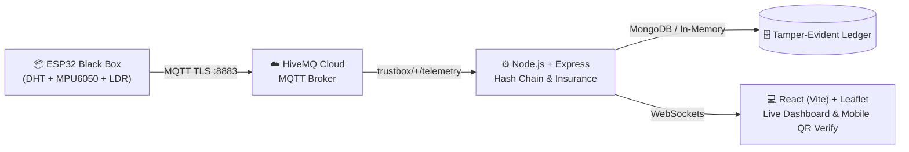

# 📦 TrustBox — Tamper-Evident Delivery Black Box & Instant Insurance Settlement

> **Hackathon Edition (24 Hours)**: Real-time cold-chain & sensitive cargo custody tracking with cryptographic hash chaining, HMAC-SHA256 signatures, and automated parametric insurance payouts.

---

## ⚡ What It Does
An ESP32-powered black box travels inside high-value cargo (vaccines, biologics, premium electronics) recording temperature, humidity, shock, tilt, light, and enclosure lid state.
- **Cryptographic Hash Chain:** Every telemetry record embeds the previous record's SHA-256 hash and is signed with HMAC-SHA256 using a private `DEVICE_KEY`.
- **Zero-Trust Verification:** Anyone scanning the QR code on the box instantly accesses `/verify/:boxId` to verify all records. If a bad actor modifies even 0.1°C in the database, the page flips from **"128 Records Intact" (Green)** to **"Tampered at #X" (Red)**.
- **Parametric Insurance Engine:** If temperature exceeds **8.0°C** for over 15 seconds or a **DROP** event occurs, an insurance claim is auto-approved with zero paperwork, generating a mock instant payout (`pay_xxx`).

---

## 🛠️ System Architecture



---

## 🚀 Quick Start Guide

### 1. Prerequisites
- **Node.js**: v18+ 
- **MongoDB**: Optional (automatic in-memory fallback enabled for zero-config hackathon demo)
- **MQTT Broker**: HiveMQ Cloud or test directly via HTTP fallback / fake publisher

### 2. Backend Setup
```bash
cd trustbox/backend
npm install
npm run dev
```
Backend runs on: `http://localhost:4000`

### 3. Frontend Setup
```bash
cd trustbox/frontend
npm install
npm run dev
```
Frontend runs on: `http://localhost:3000`

---

## 🧪 Testing Without Physical Hardware (`fake-publisher.js`)

We built a hardware simulator that generates valid, cryptographically signed, hash-chained records:

| Test Scenario | Terminal Command | Expected Behavior |
| :--- | :--- | :--- |
| **Normal Safe Journey** | `node fake-publisher.js` | Stable ~4.8°C, green safe badge, live route replay on map. |
| **Cold-Chain Breach** | `node fake-publisher.js --heat` | Temp rises to ~14.5°C. After 15s threshold, **Claim Approved** + animated payout card (`₹50,000`). |
| **Shock / Drop Impact** | `node fake-publisher.js --drop` | Immediate high-impact event. Instant claim + payout card (`₹25,000`). |
| **Lid Opened** | `node fake-publisher.js --lid` | Enclosure lid switch triggered + ambient light warning. |

---

## 🎬 2-Minute Hackathon Demo Script

1. **Open Dashboard (`http://localhost:3000`)**:
   - Status badge is glowing green: **"SAFE COLD CHAIN — ALL PARAMETERS INTACT"**.
   - Map shows simulated medical delivery corridor replay from Airport to Hospital.
2. **Scan Box QR Code**:
   - Click **"Scan QR"** on the dashboard or open `http://localhost:3000/verify/TB-001`.
   - Huge green card confirms: **"128 Records Intact"** with the chain tip SHA-256 hash.
3. **Trigger Cold-Chain Breach**:
   - Run: `node backend/fake-publisher.js --heat`
   - Watch the temperature graph cross the 8.0°C red dashed limit line.
   - Confetti burst triggers: **"Claim Approved — Instant Settlement ₹50,000"**.
4. **Demonstrate Cryptographic Tamper Detection**:
   - Click the red **"Tamper A Record"** button on the dashboard.
   - Revisit or refresh the verify page (`/verify/TB-001`).
   - The UI flips to glowing red: **"Tampered at #X"** with forensic analysis identifying the altered record.

---

## 🔒 Cryptographic Specification (Parity: ESP32 & Node.js)

1. **Canonical Field Order:**
   `box_id|seq|ts|temp_c|humidity|shock|tilt|flipped|light|lid_open|event|prev_hash`
2. **Formatting:** `temp_c` and `humidity` strictly 1 decimal place (`4.5`), booleans as `0`/`1`, empty event as `"NONE"`.
3. **Hash:** `SHA256(canonical)` (64-char lowercase hex).
4. **Signature:** `HMAC-SHA256(DEVICE_KEY, hash)` (64-char lowercase hex).
5. **Genesis:** `seq = 0`, `prev_hash = 64 zeros`.

---

## 📄 License
MIT Hackathon License. Built with ❤️ for TrustBox.

